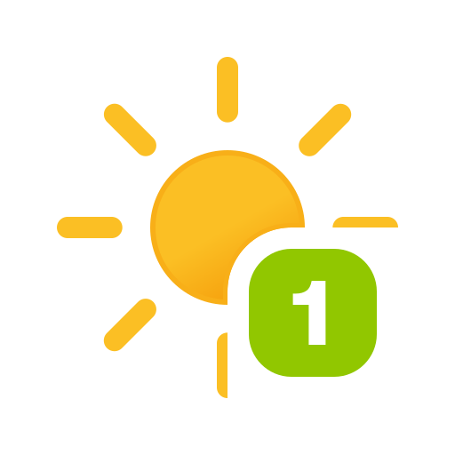
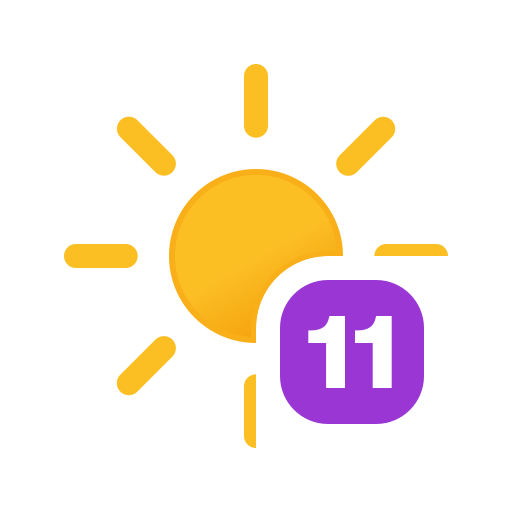

# ha-uv-card

[](https://github.com/hacs/integration)
[](https://github.com/juju35/ha-uv-card/actions/workflows/hacs.yml)
[](https://github.com/juju35/ha-uv-card/actions/workflows/validate.yml)
[](https://github.com/juju35/ha-uv-card/releases/latest)
[](LICENSE)

Lovelace card for Home Assistant that shows the current **UV index** with an animated weather-style icon, the value and the WHO risk level (Low → Extreme).

[](https://my.home-assistant.io/redirect/hacs_repository/?owner=juju35&repository=ha-uv-card&category=plugin)


## Features

- Animated icon for every UV index from 0 to 11+ (Meteocons), bundled in the card file
- Value and WHO risk level (Low, Moderate, High, Very High, Extreme) in the level's colour
- Horizontal or vertical layout, transparent mode, top alignment for stacks
- Sections view support, card picker entry with preview
- Tap to open the sensor's more-info dialog
- 7 languages, following Home Assistant's language setting

## Prerequisites

- Home Assistant 2024.8 or later
- A sensor whose state is the UV index, e.g. from [OpenUV](https://www.home-assistant.io/integrations/openuv/), [Met.no](https://www.home-assistant.io/integrations/met/) or a weather station

## Installation

### Via HACS (recommended)

[](https://my.home-assistant.io/redirect/hacs_repository/?owner=juju35&repository=ha-uv-card&category=plugin)

Or manually:

1. Open HACS → **⋮** (top right) → **Custom repositories**
2. Add `https://github.com/juju35/ha-uv-card` — Type: **Dashboard**
3. Search for **UV Index Card** and click **Download**
4. Reload the browser

### Manual

1. Download `ha-uv-card.js` from the [latest release](https://github.com/juju35/ha-uv-card/releases/latest) (icons included)
2. Copy it to `/config/www/ha-uv-card/`
3. Add the resource in **Settings → Dashboards → Resources**: `/local/ha-uv-card/ha-uv-card.js`, type **JavaScript module**

## Configuration

```yaml
type: custom:ha-uv-card
entity: sensor.uv_index
```

### Options reference

| Name         | Type    | Default              | Description                                   |
| ------------ | ------- | -------------------- | --------------------------------------------- |
| `entity`     | string  | **required**         | A sensor whose state is the UV index (0–11+).            |
| `name`       | string  | entity friendly name | Title shown on the card.                                 |
| `show_value` | boolean | `true`               | Show the numeric UV value.                               |
| `show_label` | boolean | `true`               | Show the risk label (Low … Extreme).                     |
| `layout`     | string  | `horizontal`         | `horizontal` (text to the right) or `vertical` (text below the icon). |
| `transparent`| boolean | `false`              | Remove the card background, border and shadow.           |
| `align`      | string  | `center`             | `center` or `top`. Vertical alignment of the content — use `top` to line the card up with others in a `horizontal-stack`. |
| `language`   | string  | Home Assistant UI    | Force a language code (e.g. `fr`). Defaults to your HA UI. |

### Risk levels

| Icon | UV index | Level     | Color  |
| ---- | -------- | --------- | ------ |
|   | 0–2  | Low       | green  |
|   | 3–5  | Moderate  | yellow |
|   | 6–7  | High      | orange |
|   | 8–10 | Very High | red    |
|  | 11+  | Extreme   | purple |

## Screenshots

| Light | Dark | Vertical | Unavailable |
|---|---|---|---|
|  |  |  |  |

## Animations

One animated icon per WHO risk band — the sun rays sweep continuously while the badge, value and label take the band's colour.

| Animation | Description |
|---|---|
|  | **Low (0–2)** — green badge, animated sun. |
|  | **Moderate (3–5)** — yellow badge, animated sun. |
|  | **High (6–7)** — orange badge, animated sun. |
|  | **Very High (8–10)** — red badge, animated sun. |
|  | **Extreme (11+)** — purple 11+ badge, animated sun. |

## How it works

The card reads the sensor's state, rounds it, then uses that rounded value both to pick one of the 12 icons (0 to 11, higher values use 11) and to map it to the WHO bands, so the value, icon and risk level always agree. The card is built once; afterwards it only updates its text, colour and layout attributes when the state, name, language or configuration change, and swaps the icon only when the rounded index changes, so the icon animation doesn't restart on every Home Assistant update. Any non-numeric or empty state shows the unavailable icon; a negative reading shows 0.

## Development

```bash
npm install
npm run build        # src/ + icons/ → dist/ha-uv-card.js
npm run check        # builds and checks the card (run in CI)
npm run screenshots  # renders the README screenshots
npm run gifs         # records the README GIFs, one per risk band (needs ffmpeg)
```

The **Screenshots** workflow re-renders the screenshots and GIFs on every pull request that touches `src/`, `icons/`, `scripts/` or the Playwright version (`package.json`, `package-lock.json`) and commits them back onto the PR branch (pull requests from forks are only rendered, not committed; a manual run uploads them as an artifact). The commit is pushed with `GITHUB_TOKEN`, so it does not re-trigger the other checks; push again or close and reopen the PR to re-run them.

`dist/` is not committed: `npm run build` creates it locally, CI builds it on every push, and the release workflow attaches the built file to the release, which is where HACS downloads it from.

### Releasing

1. Bump `version` in `package.json`
2. Add a `## <version>` section at the top of [CHANGELOG.md](CHANGELOG.md)
3. Push to `main`: the **Release** workflow builds the card, creates the tag and the GitHub release with the changelog section as notes, and attaches `ha-uv-card.js`

## Translations

The card follows the language of Home Assistant (or `language`). Currently supported:

| Language | Code |
|---|---|
| English | `en` |
| Français | `fr` |
| Deutsch | `de` |
| Español | `es` |
| Italiano | `it` |
| Nederlands | `nl` |
| Português | `pt` |

Add a language in the `TRANSLATIONS` map of `src/ha-uv-card.js`. Contributions welcome!

## License

[MIT](LICENSE)

UV index icons from [Meteocons](https://github.com/basmilius/weather-icons) by Bas Milius (MIT).
