# ha-uv-card

[](https://www.home-assistant.io/integrations/marketplace/)
[](https://github.com/juju35/ha-uv-card/actions/workflows/hacs.yml)
[](https://github.com/juju35/ha-uv-card/actions/workflows/validate.yml)
[](https://github.com/juju35/ha-uv-card/actions/workflows/lint.yml)
[](https://github.com/juju35/ha-uv-card/releases/latest)
[](https://github.com/juju35/ha-uv-card/blob/main/LICENSE)
[](https://buymeacoffee.com/julienstep9)

<p align="center">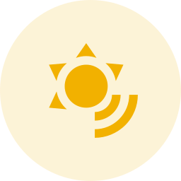</p>

Lovelace card for Home Assistant that shows the current **UV index** on a half-circle gauge split into the five WHO risk bands, with the WHO risk level (Low → Extreme), a short sun protection advice and an animated weather-style icon.

[](https://my.home-assistant.io/redirect/marketplace_repository/?owner=juju35&repository=ha-uv-card&category=plugin)

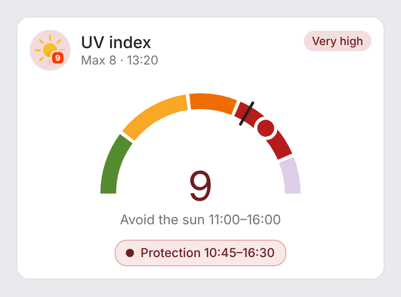

## Features

- Half-circle gauge from 0 to 11+ in the five WHO bands (green 0–2, yellow 3–5, orange 6–7, red 8–10, violet 11+): the bands above the current value are dimmed, a marker glides along the arc to the new value and pulses gently at Very high and Extreme
- Big value in the centre and WHO risk level pill (Low, Moderate, High, Very high, Extreme) in the level's colour
- Short WHO sun protection advice per level (e.g. "SPF 30+ · hat · shade at noon"), can be hidden
- Animated icon for every UV index from 0 to 11+ (Meteocons) in the header badge, bundled in the card file, or an icon of your choice
- Optional daily max UV (subtitle "Max 8 · 13:20" and a tick on the gauge) and sun protection window footer, highlighted while it is on (e.g. from OpenUV)
- Vertical (default) or horizontal layout, transparent mode, top alignment for stacks; band colours themable
- Sections view support, card picker entry with preview, visual editor
- Tap to open the sensor's more-info dialog
- 22 languages, following Home Assistant's language setting

## Prerequisites

- Home Assistant 2024.11 or later
- A sensor whose state is the UV index (e.g. from [OpenUV](https://www.home-assistant.io/integrations/openuv/) or a weather station), or a weather entity that has a `uv_index` attribute (e.g. [Met.no](https://www.home-assistant.io/integrations/met/))

## Installation

### Via the Marketplace (recommended)

[](https://my.home-assistant.io/redirect/marketplace_repository/?owner=juju35&repository=ha-uv-card&category=plugin)

Or manually:

1. Open **Settings → Marketplace → Add from link** (top right; this needs a GitHub account connected)
2. Add `https://github.com/juju35/ha-uv-card` — Type: **Dashboard**
3. Open **UV Index Card** and click **Install**
4. Reload the browser

### Manual

1. Download `ha-uv-card.js` and the `ha-uv-card.i18n.*.js` translation files from the [latest release](https://github.com/juju35/ha-uv-card/releases/latest) (icons included)
2. Copy them all to `/config/www/ha-uv-card/` (without the translation files, the cards show in English)
3. Add the resource in **Settings → Dashboards → Resources**: `/local/ha-uv-card/ha-uv-card.js`, type **JavaScript module**

## Configuration

```yaml
type: custom:ha-uv-card
entity: sensor.uv_index
```

### Options reference

| Name         | Type    | Default              | Description                                   |
| ------------ | ------- | -------------------- | --------------------------------------------- |
| `entity`     | string  | **required**         | A sensor whose state is the UV index (0–11+), or a `weather` entity, whose `uv_index` attribute is read. |
| `name`       | string  | entity friendly name | Title shown on the card.                                 |
| `show_title` | boolean | `true`               | Show the title (the name), e.g. `false` under a section heading of your own. |
| `max_entity` | string  | —                    | A sensor with the day's maximum UV index (OpenUV `sensor.*_max_uv_index`). Shows "Max 8 · 13:20" as the subtitle, the time from its `time` attribute, and a tick on the gauge at the max. |
| `protection_entity` | string | —             | A binary sensor for the sun protection window (OpenUV `binary_sensor.*_protection_window`). Shows its `start_time`–`end_time` in the footer, highlighted while it is on; without times, "Protection needed" while it is on. |
| `show_value` | boolean | `true`               | Show the numeric UV value.                               |
| `show_label` | boolean | `true`               | Show the risk level pill (Low … Extreme) in the header.  |
| `show_advice`| boolean | `true`               | Show the WHO sun protection advice under the value.      |
| `icon`       | string  | animated icon        | An icon for the header badge (e.g. `mdi:weather-sunny`) instead of the animated Meteocons icon of the current index. |
| `layout`     | string  | `vertical`           | `vertical` (value in the gauge, advice under it) or `horizontal` (gauge on the left, value and advice on the right; stacked like `vertical` when the card is narrower than 300 px). |
| `transparent`| boolean | `false`              | Remove the card background, border and shadow.           |
| `align`      | string  | `center`             | `center` or `top`. Vertical alignment of the content inside the card, which fills its cell in the sections view — use `top` to line the card up with others in a `horizontal-stack`. |
| `language`   | string  | Home Assistant UI    | Force a language code (e.g. `fr`). Defaults to your HA UI. |

With OpenUV, the max UV goes to the subtitle and the gauge, the protection window to the footer (times follow Home Assistant's 12/24 h and time zone settings):

```yaml
type: custom:ha-uv-card
entity: sensor.openuv_current_uv_index
max_entity: sensor.openuv_max_uv_index
protection_entity: binary_sensor.openuv_protection_window
```

With Met.no (or another weather integration that provides the UV index):

```yaml
type: custom:ha-uv-card
entity: weather.forecast_home
```

Side by side, gauge on the left:

```yaml
type: custom:ha-uv-card
entity: sensor.uv_index
layout: horizontal
```

### Risk levels

| Icon | UV index | Level     | Color  | Advice |
| ---- | -------- | --------- | ------ | ------ |
| 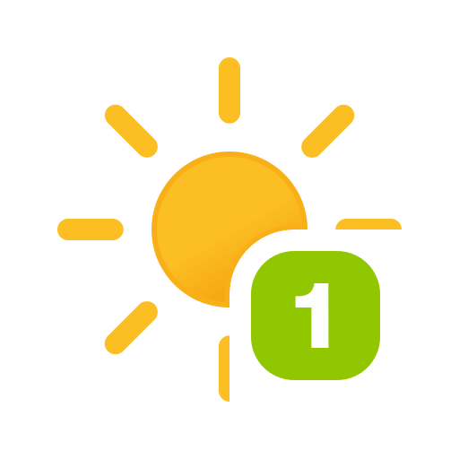  | 0–2  | Low       | green  | No protection needed |
|   | 3–5  | Moderate  | yellow | Sunglasses · SPF 30+ at midday |
| 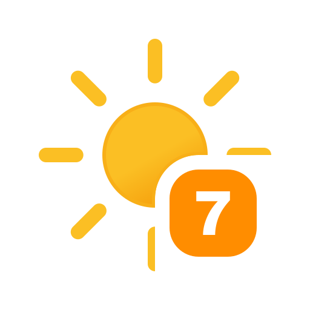  | 6–7  | High      | orange | SPF 30+ · hat · shade at noon |
| 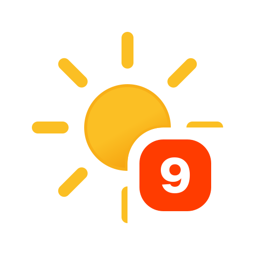  | 8–10 | Very high | red    | Avoid the sun 11:00–16:00 |
| 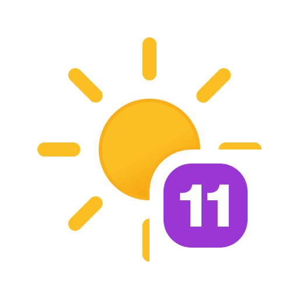 | 11+  | Extreme   | violet | Stay inside if possible |

### Theme variables

The band colours can be changed from a theme (or `card_mod`); each falls back to the colour above.

| Variable | Default |
| -------- | ------- |
| `--uv-low-color` | `#558b2f` |
| `--uv-moderate-color` | `#f9a825` |
| `--uv-high-color` | `#ef6c00` |
| `--uv-very-high-color` | `#b71c1c` |
| `--uv-extreme-color` | `#6a1b9a` |

## Screenshots

| | Light | Dark |
|---|---|---|
| Vertical (default), with max UV and protection window |  | 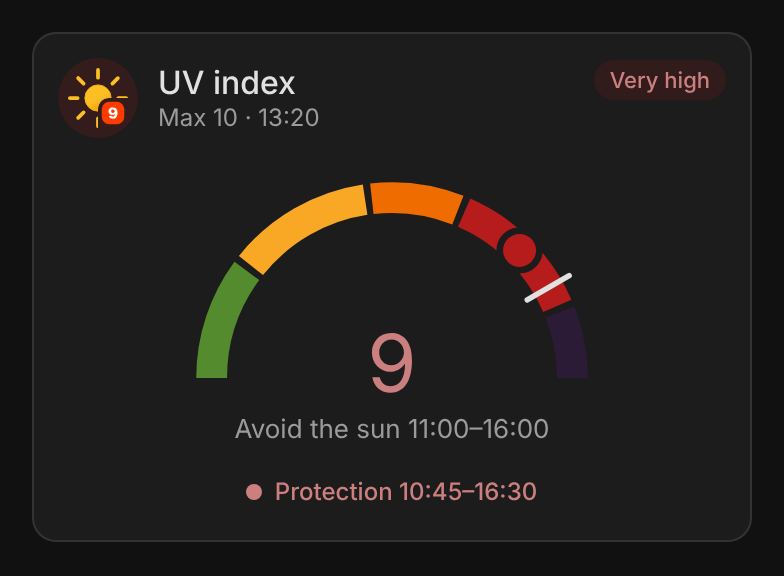 |
| Horizontal | 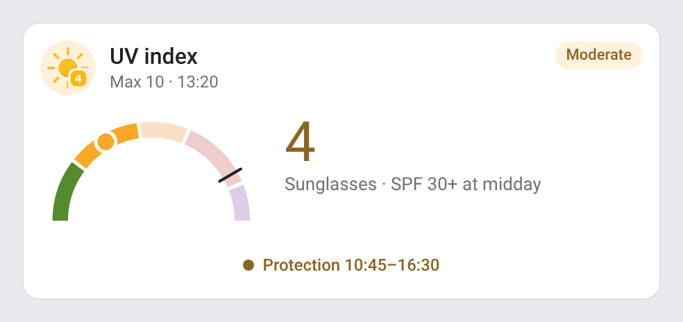 | 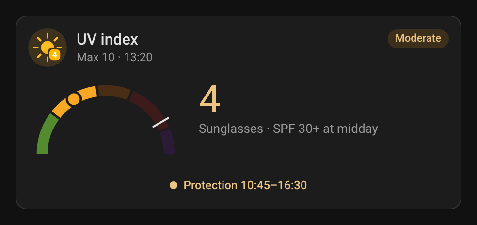 |
| Compact | 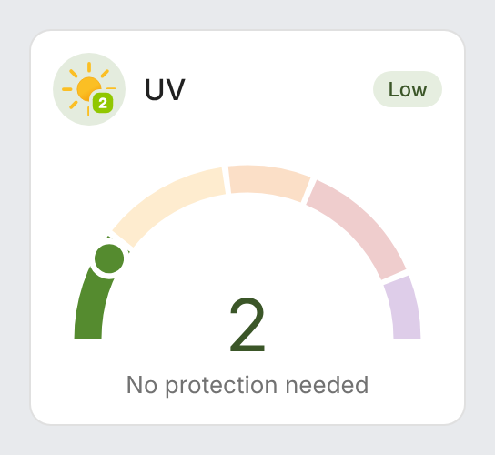 | 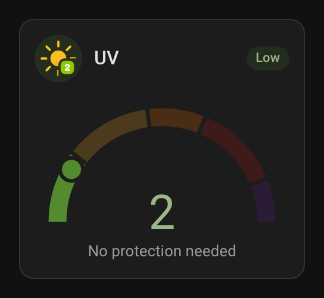 |
| Unavailable | 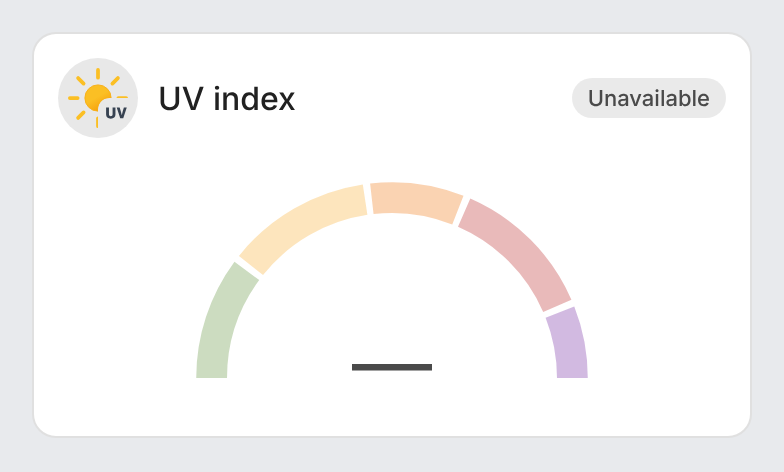 | 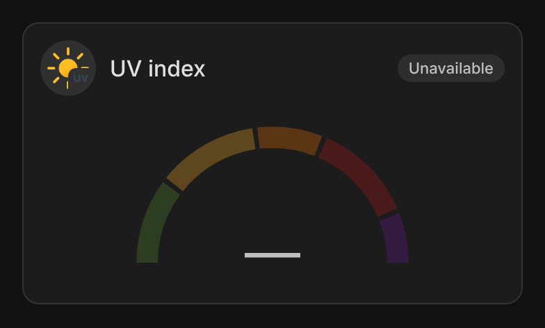 |

### Animations

One GIF per WHO risk band. The card starts at 0, then the value arrives: the marker glides along the gauge to it, the bands above it dim and the badge, value and pill take the band's colour, mixed with the theme text colour so that they stay readable in light and dark themes. The sun rays of the badge icon sweep continuously, and at Very high and Extreme the marker pulses gently. Everything stays still when the system or browser asks to reduce motion, and pauses while the card is off-screen.

| Light | Dark | Description |
|---|---|---|
| 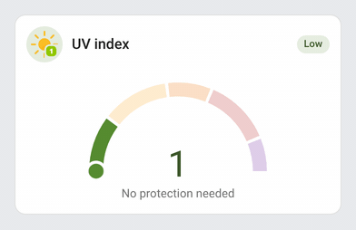 | 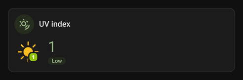 | **Low (0–2)** — green band, "No protection needed". |
| 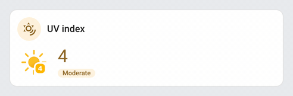 | 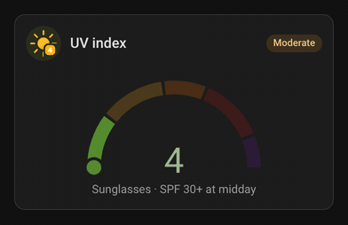 | **Moderate (3–5)** — the marker glides into the yellow band. |
| 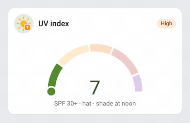 | 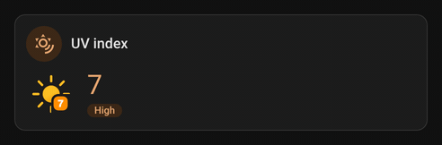 | **High (6–7)** — orange band, red and violet dimmed. |
| 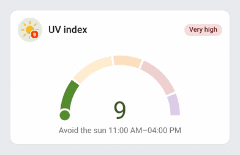 | 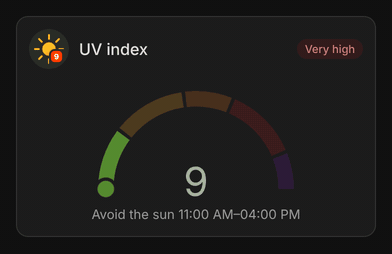 | **Very high (8–10)** — red band, the marker pulses. |
| 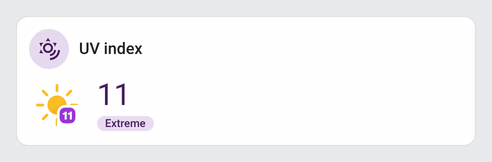 | 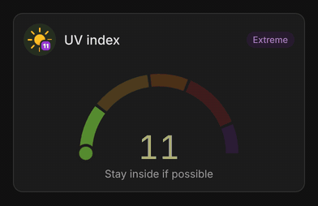 | **Extreme (11+)** — violet band at the end of the gauge, pulsing marker. |

## How it works

The card reads the sensor's state (or a weather entity's `uv_index` attribute), rounds it, then uses that rounded value to pick one of the 12 icons (0 to 11, higher values use 11), to map it to the WHO bands and to place the marker on the gauge (0 to 12, each band starting halfway between two whole numbers), so the value, marker, icon, risk level and advice always agree. The card is built once; afterwards it only updates its text, attributes and CSS variables when the state, name, language or configuration change: the marker and the max tick turn by a CSS transition, so they glide instead of jumping, and the icon is swapped only when the rounded index changes, so its animation doesn't restart on every Home Assistant update. The animations are paused while the card is off-screen or the browser tab is hidden. Any non-numeric or empty state dims the gauge, hides the marker and the advice and shows the unavailable icon, labelled "Unknown" while the sensor has not reported yet (`unknown`) and "Unavailable" otherwise; a negative reading shows 0.

## Development

```bash
npm install
npm run build        # src/ + icons/ → dist/ha-uv-card.js
npm run check        # builds and checks the card (run in CI)
npm run screenshots  # renders the README screenshots
npm run gifs         # records the README GIFs, the marker animation per risk band (needs ffmpeg)
```

The **Screenshots** workflow re-renders the screenshots and GIFs on every pull request that touches `src/`, `icons/`, `scripts/` or the Playwright version (`package.json`, `package-lock.json`) and commits them back onto the PR branch (pull requests from forks are only rendered, not committed; a manual run uploads them as an artifact). The `pull_request` runs created by that bot commit are left waiting for approval (they show as failed with no job once the PR is merged), so after committing the workflow dispatches Lint, Validate and HACS on the PR branch to check the new commit.

`dist/` is not committed: `npm run build` creates it locally, CI builds it on every push, and the release workflow attaches the built file to the release, which is where the Marketplace installs it from.

### Releasing

1. Bump `version` in `package.json`
2. Add a `## <version>` section at the top of [CHANGELOG.md](https://github.com/juju35/ha-uv-card/blob/main/CHANGELOG.md)
3. Push to `main`: the **Release** workflow builds the card, creates the tag and the GitHub release with the changelog section as notes, and attaches `ha-uv-card.js`

## Translations

The card follows the language of Home Assistant (or `language`). Currently supported:

| Language | Code |
|---|---|
| English | `en` |
| Français | `fr` |
| Deutsch | `de` |
| Español | `es` |
| Italiano | `it` |
| Nederlands | `nl` |
| Português (Portugal) | `pt` |
| Polski | `pl` |
| Română | `ro` |
| Dansk | `da` |
| Svenska | `sv` |
| Български | `bg` |
| Русский | `ru` |
| Українська | `uk` |
| Magyar | `hu` |
| Slovenčina | `sk` |
| Čeština | `cs` |
| Slovenščina | `sl` |
| Latviešu | `lv` |
| Ελληνικά | `el` |
| Српски (Serbian, Cyrillic) | `sr` |
| Srpski (Serbian, Latin) | `sr-Latn` |

Add a language in the `TRANSLATIONS` map of `src/ha-uv-card.js`. Contributions welcome!

## License

[MIT](https://github.com/juju35/ha-uv-card/blob/main/LICENSE)

UV index icons from [Meteocons](https://github.com/basmilius/weather-icons) by Bas Milius (MIT).

## Support

If you find this project useful, you can support its development:

<a href="https://buymeacoffee.com/julienstep9"></a>
