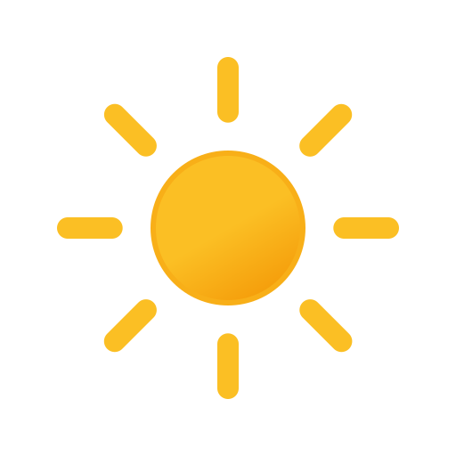
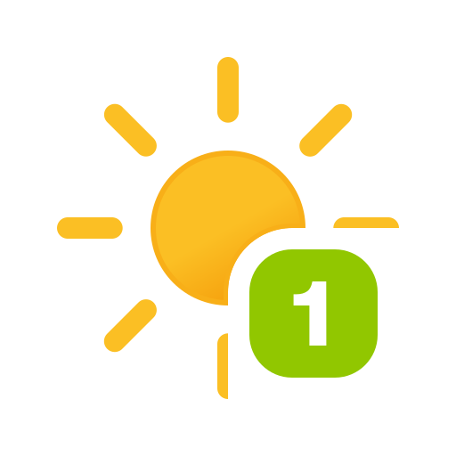
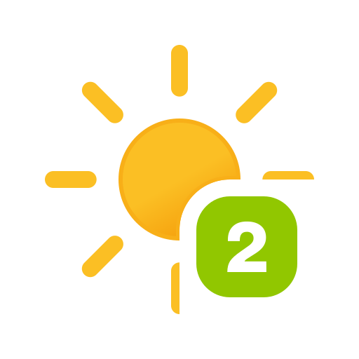
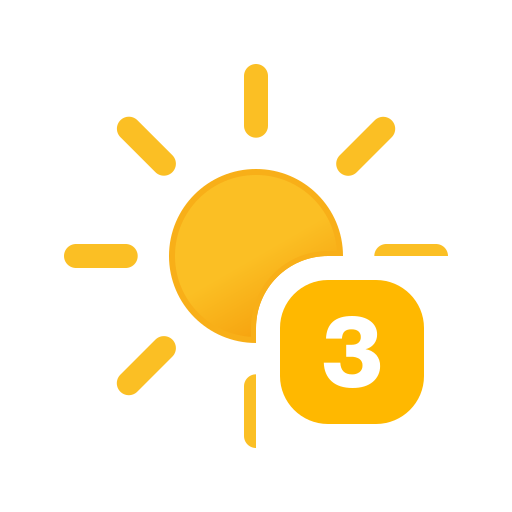
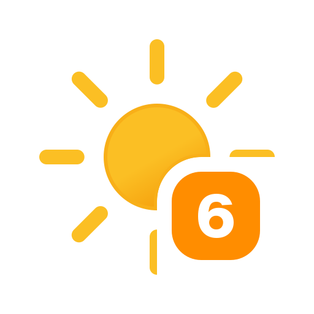
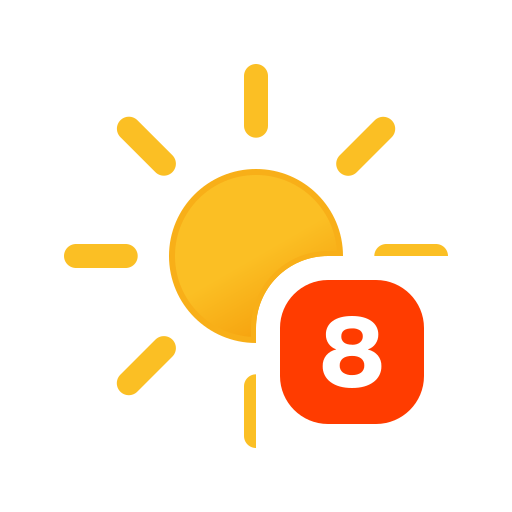
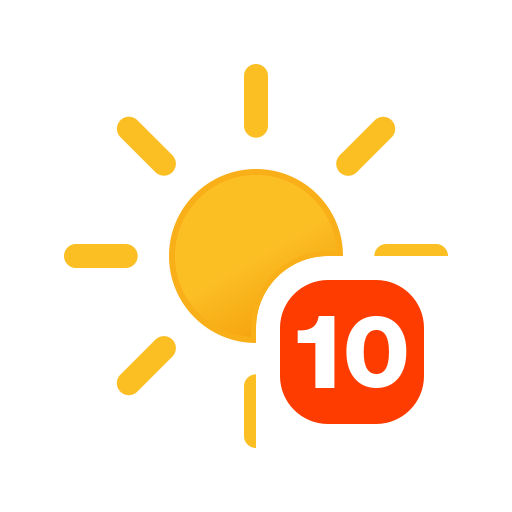
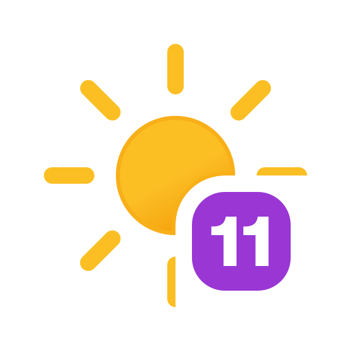

# UV Index Card

[](https://github.com/hacs/integration)
[](https://github.com/juju35/ha-uv-card/actions/workflows/hacs.yml)
[](https://github.com/juju35/ha-uv-card/actions/workflows/check.yml)
[](https://github.com/juju35/ha-uv-card/releases/latest)
[](LICENSE)

A custom Lovelace card for Home Assistant that displays the current **UV index**
with an animated weather-style icon, the numeric value and the WHO risk level
(Low → Extreme).

## Preview

<p align="center">
  
  
  
  
  
  
  
  
  
  
  
  
</p>

---

## Installation

### HACS (recommended)

This is a custom repository. Click the button below to add it to your Home
Assistant instance:

[](https://my.home-assistant.io/redirect/hacs_repository/?owner=juju35&repository=ha-uv-card&category=plugin)

Or manually:

1. Open **HACS → Frontend**.
2. Click the menu (⋮) → **Custom repositories**.
3. Add `https://github.com/juju35/ha-uv-card` with category **Dashboard / Plugin**.
4. Install **UV Index Card** and reload your browser.

### Manual

1. Download `ha-uv-card.js` from the
   [latest release](https://github.com/juju35/ha-uv-card/releases)
   (everything, including the icons, is bundled in that single file).
2. Copy it to `config/www/ha-uv-card/`.
3. Add the resource in **Settings → Dashboards → Resources**:

   ```yaml
   url: /local/ha-uv-card/ha-uv-card.js
   type: module
   ```

---

## Usage

Add the card to a dashboard:

```yaml
type: custom:ha-uv-card
entity: sensor.uv_index
```

### Options

| Name         | Type    | Default              | Description                                   |
| ------------ | ------- | -------------------- | --------------------------------------------- |
| `entity`     | string  | **required**         | A sensor whose state is the UV index (0–11+).            |
| `name`       | string  | entity friendly name | Title shown on the card.                                 |
| `show_value` | boolean | `true`               | Show the numeric UV value.                               |
| `show_label` | boolean | `true`               | Show the risk label (Low … Extreme).                     |
| `layout`     | string  | `horizontal`         | `horizontal` (text to the right) or `vertical` (text below the icon). |
| `transparent`| boolean | `false`              | Remove the card background, border and shadow.           |
| `align`      | string  | `center`             | `center` or `top`. Vertical alignment of the content — use `top` to line the card up with others in a `horizontal-stack`. |
| `language`   | string  | Home Assistant UI    | Force a language code (e.g. `fr`). Defaults to your HA UI. |

### Translations

Risk labels and the default title are translated and follow your Home Assistant
language automatically. Built-in: **en, fr, de, es, it, nl, pt** (falls back to
English). Add a language by extending the `TRANSLATIONS` map in `ha-uv-card.js`
— contributions welcome.

### Risk levels

| Icon | UV index | Level     | Color  |
| ---- | -------- | --------- | ------ |
|   | 0–2  | Low       | green  |
|   | 3–5  | Moderate  | yellow |
|   | 6–7  | High      | orange |
|   | 8–10 | Very High | red    |
|  | 11+  | Extreme   | purple |

---

## Credits

UV index icons are from the [Meteocons](https://github.com/basmilius/weather-icons)
set by Bas Milius (MIT).

## License

[MIT](LICENSE)
